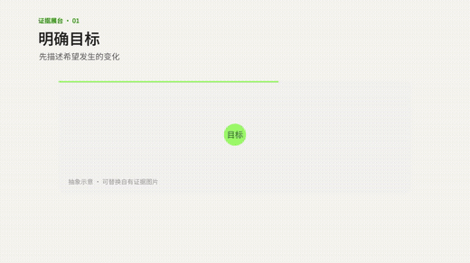
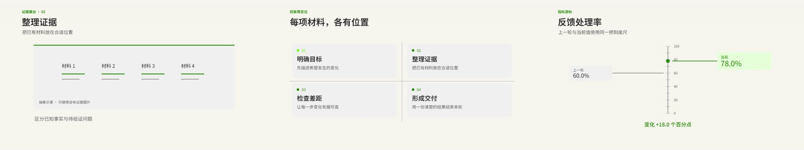

# Goals & Evidence · 17 Motion Diagram Types

Seventeen types of semantic motion diagrams in warm gray, off-white and green, for explainers, product descriptions, metric comparisons and arguments.

**16:9 · 1280 × 720 · 24 fps · v0.4.0-rc.5** · [@frankye1211](https://motiongit.com/@frankye1211) · [简体中文](README.zh-CN.md)

**[Template details, full .motion & demo](https://motiongit.com/@frankye1211/product-update-story)**
https://motiongit.com/@frankye1211/product-update-story

Download available; current terms are listed with the package.

## Demo

[Full demo](https://motiongit.com/@frankye1211/product-update-story) · [Play video](https://media.openaicut.com/previews/886/0.4.0-rc.4-7ab29961149d.mp4)

## How it works

- Declared runtime profile: native-python-node/1.
- Editable inputs are mapped through the template parameter schema and preset to its existing animation project.
- The declared duration policy follows the current voiceover; the package plan determines final timing rather than the demo length.

Demo duration: **72s**. The documented output is 1280 × 720, 24 fps. The public demo is 72 seconds. Use the actual package parameter bounds; extra materials do not automatically create extra scenes.

## Inputs and materials

- **Optional:** The current voice recording or your narration preference for this production.
- **Optional:** A transcript or SRT matching the current narration/video.
- **Optional:** Your current talking-head video with its original audio for the native presenter workflow.
- **Optional:** A licensed music track or your preference for music in this production.

Useful for: Seventeen types of semantic motion diagrams in warm gray, off-white and green, for explainers, product descriptions, metric comparisons and arguments.

## Runtime requirements

- Declared runtime profile: native-python-node/1. Dependencies: python 3.11+ standard library only, node 22+, playwright existing module, ffmpeg existing executable, ffprobe existing executable. Check the downloaded package for exact tools and setup steps.
- Use the package dependency lock and setup/check instructions. Check existing tools first, install only missing requirements and verify a preview.

## Use the template

1. Obtain the current .motion package from the [template page](https://motiongit.com/@frankye1211/product-update-story).
2. Extract or load it as documented, then read the included README and referenced production guide.
3. Use your own content and materials, reuse the working environment, and follow the package entry point to inspect a real preview.

You can give an assistant the repository URL and this request:

> https://github.com/motiontemplates/509099
>
> Use this .motion template with my content. Obtain the package from https://motiongit.com/@frankye1211/product-update-story, extract or load it as documented, read the included README and referenced guide, reuse my working environment, and follow the package workflow to show an actual preview.

## .motion format

MotionGit .motion is a reusable video-template format that organizes the animation project, parameters, assets, dependencies and production guide. Its runtime uses new content to produce a finished video. [Format documentation](https://motiongit.com/spec)

[Versions, license & full download](https://motiongit.com/@frankye1211/product-update-story) · [Production reference](ASSISTANT.md)
